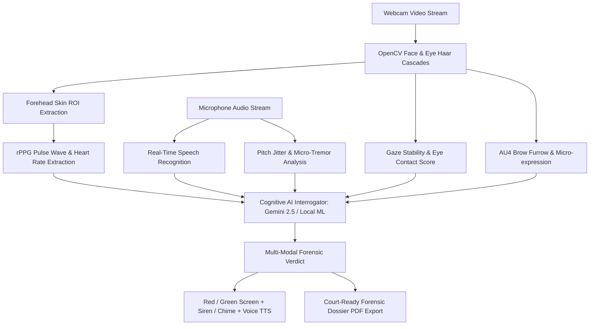

# 🧠 Forensic AI Polygraph & Criminal Investigation Interrogator
### *Multi-Modal Contactless Lie Detection, rPPG Biosensing, Speech Deception NLP & Court Evidence Dossier Generator*

[](https://www.python.org/)
[](https://flask.palletsprojects.com/)
[](https://opencv.org/)
[](https://ai.google.dev/)
[](https://www.reportlab.com/)

An advanced, research-grade **AI Polygraph & Criminal Deception Detection System** designed for high-stakes interrogation simulations. Powered by contactless remote Photoplethysmography (rPPG), Facial Action Coding System (FACS micro-expressions), Web Speech API linguistic NLP, and Google Gemini 2.5 Flash cognitive reasoning.

---

## 🌟 Key Capabilities

### 1. 🫀 Contactless rPPG Pulse Extraction
* Real-time heart rate (BPM) extraction from forehead skin color micro-fluctuations (blood volume pulse).
* Computes real-time $\Delta\text{BPM}$ tachycardia spikes above calibrated baseline.

### 2. 👁️ Gaze Alignment & FACS Micro-Expressions
* Eye contact stability score (0–100%) tracking direct vs. averted gaze.
* Detects Facial Action Units (AU4 Brow Furrowing tension, AU12 lip tension).

### 3. 🗣️ Real-Time Speech & Linguistic Deception NLP
* Continuous Speech-to-Text streaming in English and Hindi (`hi-IN`).
* Detects emphatic over-promising (*"kasam se"*, *"I swear"*, *"honestly"*), fabrication latency fillers, and evasive deflections.

### 4. 🧠 Dual Cognitive AI Interrogator
* **Mode A: Google Gemini 2.5 Flash:** Deep context-aware forensic analysis cross-examining suspect statements against alleged crime facts.
* **Mode B: Local Cognitive Semantic Engine (100% Offline):** Zero-latency NLP evaluation of confessions, contradictions, and biometric betrayal.

### 5. 🚨 Dramatic High-Stakes Audio-Visual Verdicts
* **LIE DETECTED:** Intense Neon Red alert + flashing police sirens + alarm warble + TTS voice: *"Sorry sir, you are lying."*
* **TRUTH VERIFIED:** Cyber Green glow + sci-fi harmonic chime + TTS voice: *"Yes, this is truth."*

### 6. 📁 Criminal Case Dossier & Court Evidence PDF Export
* Full Suspect Profiling (Name, Age, Gender, Case ID, Allegation Brief).
* 4 Specialized Crime Scenarios:
  * 🏦 **High-Value Vault & Bank Robbery**
  * 🔪 **Homicide & Murder Investigation**
  * 💻 **Corporate Cyber Espionage & Embezzlement**
  * 🔍 **General Police Integrity Screening**
* Generates an official, court-ready **Forensic Investigation Dossier PDF** with itemized cross-examination logs, physiological telemetry, and examiner signature blocks.

---

## 🏗️ Architecture & Pipeline



---

## 🚀 Quickstart & Installation

### 1. Clone Repository
```bash
git clone https://github.com/YOUR_USERNAME/ai-lie-detector.git
cd ai-lie-detector
```

### 2. Install Dependencies
```bash
pip install -r requirements.txt
```

### 3. Configure Gemini API Key (Optional)
Create a `.env` file or enter it directly via the in-app HUD:
```env
GEMINI_API_KEY=your_gemini_api_key_here
```
*(If no API key is provided, the system automatically uses the built-in Local Cognitive Semantic Engine 100% offline).*

### 4. Run the Server
```bash
python app.py
```
Open **[http://127.0.0.1:5000](http://127.0.0.1:5000)** in Google Chrome or any modern browser.

---

## 📂 Project Structure

```text
├── app.py                         # Flask server & hardware vision pipeline
├── cognitive_interrogator.py      # Gemini 2.5 + Local Semantic Reasoning Engine
├── forensic_dossier_generator.py  # ReportLab court-ready Evidence Dossier PDF
├── generate_pdf_report.py         # Technical architecture documentation PDF
├── haarcascade_frontalface_default.xml # OpenCV Face Cascade
├── haarcascade_eye.xml            # OpenCV Eye Cascade
├── requirements.txt               # Dependencies
├── static/
│   ├── css/style.css             # Cyberpunk HUD & forensic theme styles
│   └── js/
│       ├── detector.js            # Interrogation engine & case controller
│       ├── face_tracker.js        # Optical telemetry client
│       ├── polygraph.js           # 4-channel real-time oscillograph
│       ├── audio_analyzer.js      # Web Audio pitch jitter & SFX / TTS
│       └── speech_analyzer.js     # Speech recognition & deception dictionary
└── templates/
    └── index.html                 # Tactical Investigation HUD Interface
```

---

## ⚖️ Legal & Ethical Disclaimer
This project is engineered for educational, forensic research, and technical demonstration purposes. In judicial systems, polygraph and biometric analysis operate as corroborative investigative tools.
